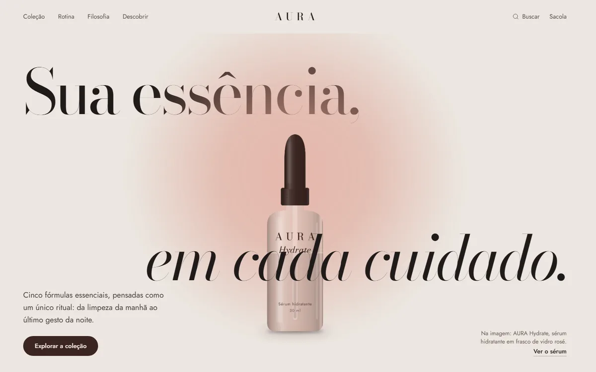
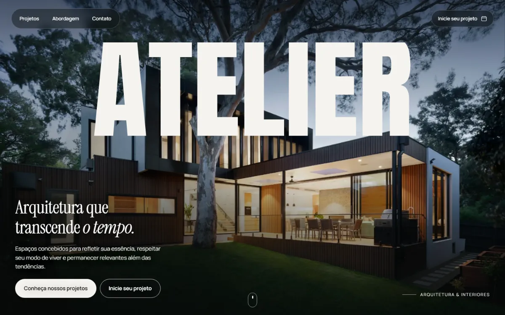
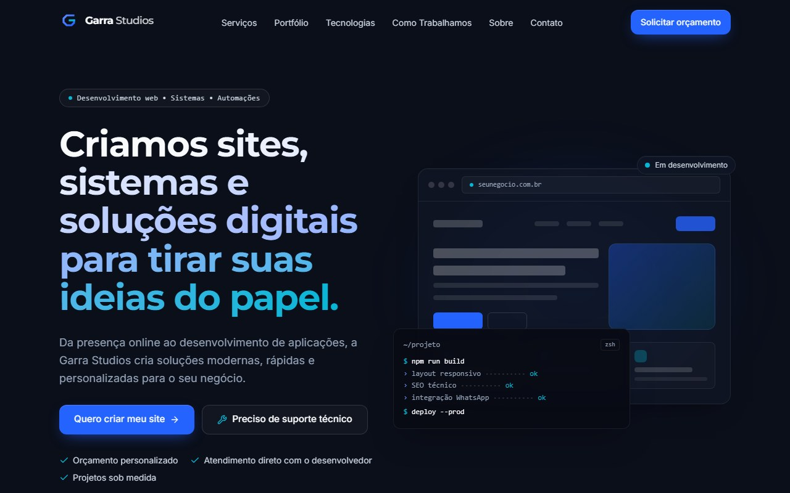
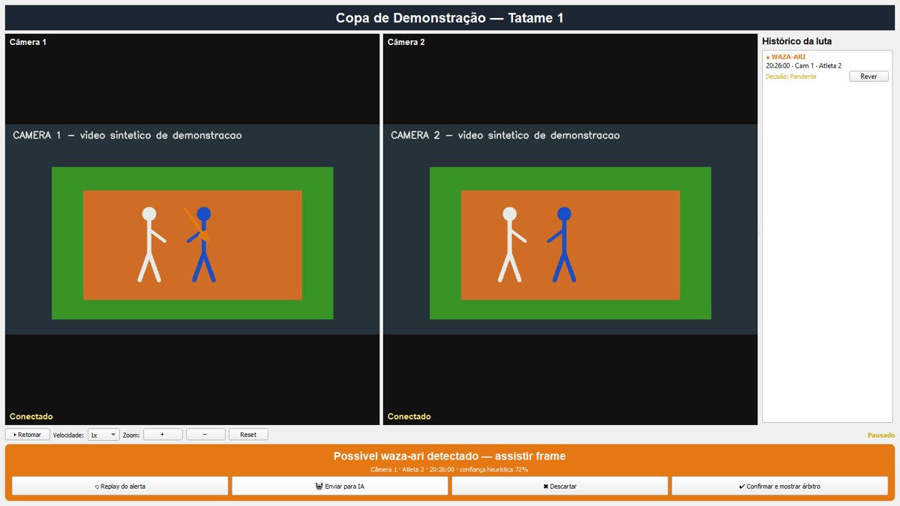

<a href="https://garrastudios.online">
  
</a>

<p align="center">
  <a href="https://garrastudios.online"></a>
  <a href="https://wa.me/5561992262196?text=Ol%C3%A1%2C%20Murilo!%20Vi%20seu%20GitHub%20e%20gostaria%20de%20conversar%20sobre%20um%20projeto."></a>
  <a href="https://garrastudios.online/#contato"></a>
</p>

<br>

## Olá, eu sou o Murilo

Desenvolvedor Full Stack e fundador da **[Garra Studios](https://garrastudios.online)**. Trabalho com aplicações web, integrações, automações e infraestrutura, do primeiro contato até o deploy.

Meu foco é transformar necessidades reais em software que funciona: código organizado, escopo claro e comunicação direta com quem desenvolve o projeto.

<br>

## O que eu faço

<table>
  <tr>
    <td width="50%" valign="top">
      <h4>Sites e landing pages</h4>
      Sites institucionais e páginas de conversão responsivas, com SEO técnico e carregamento otimizado.
    </td>
    <td width="50%" valign="top">
      <h4>Sistemas web</h4>
      Painéis, áreas logadas e ferramentas internas com banco de dados relacional e controle de acesso.
    </td>
  </tr>
  <tr>
    <td valign="top">
      <h4>Integrações e automações</h4>
      APIs, WhatsApp, IA generativa, scrapers e fluxos que eliminam trabalho manual.
    </td>
    <td valign="top">
      <h4>Infraestrutura e deploy</h4>
      VPS Linux, Nginx, HTTPS e publicação com troca atômica de versão e rollback.
    </td>
  </tr>
  <tr>
    <td valign="top">
      <h4>Manutenção e correção de bugs</h4>
      Diagnóstico de erros, falhas de integração e problemas de hospedagem em sistemas existentes.
    </td>
    <td valign="top">
      <h4>Parcerias com agências</h4>
      Desenvolvimento white-label e apoio técnico para agências de marketing e software.
    </td>
  </tr>
</table>

<br>

## Stack

| Área | Tecnologias |
|---|---|
| **Front-end** |         |
| **Back-end** |      |
| **Dados** |      |
| **IA e integrações** |  -111827?style=flat-square&logo=whatsapp&logoColor=06B6D4)   |
| **Infra e qualidade** |      |

<br>

## Projetos em destaque

<table>
  <tr>
    <td width="50%" valign="middle">
      <h3>AURA — Skincare &amp; Beauty</h3>
      Loja virtual conceito para uma marca fictícia de skincare: identidade visual própria, catálogo com busca, filtros e ordenação, sacola salva no navegador e checkout demonstrativo com validação. Pensada primeiro para o celular.
      <br><br>
      <code>Next.js</code> <code>React</code> <code>TypeScript</code> <code>Tailwind CSS</code> <code>Zustand</code> <code>Motion</code>
      <br><br>
      <a href="https://aura.garrastudios.online"><b>Ver demo</b></a> · <a href="https://github.com/murilo0238/aura-skincare">Código</a>
    </td>
    <td width="50%" valign="middle">
      <a href="https://aura.garrastudios.online"></a>
    </td>
  </tr>
  <tr>
    <td width="50%" valign="top">
      <a href="https://atelier.garrastudios.online"></a>
      <h3>ATELIER</h3>
      Landing page conceito para uma marca fictícia de arquitetura e interiores. Animações ao rolar, seletor de projetos, menu mobile e verificação automatizada em 4 tamanhos de tela.
      <br><br>
      <code>HTML</code> <code>CSS</code> <code>JavaScript</code> <code>Playwright</code>
      <br><br>
      <a href="https://atelier.garrastudios.online"><b>Ver demo</b></a> · <a href="https://github.com/murilo0238/atelier-landing">Código</a>
    </td>
    <td width="50%" valign="top">
      <a href="https://garrastudios.online"></a>
      <h3>Site Garra Studios</h3>
      Site institucional com exportação estática servida pelo Nginx, SEO técnico completo, formulário que gera a mensagem para o WhatsApp e testes end-to-end em desktop e mobile.
      <br><br>
      <code>Next.js</code> <code>React</code> <code>TypeScript</code> <code>Tailwind CSS</code> <code>Nginx</code>
      <br><br>
      <a href="https://garrastudios.online"><b>Ver site</b></a> · <a href="https://github.com/murilo0238/garra-studios-site">Código</a>
    </td>
  </tr>
  <tr>
    <td width="50%" valign="middle">
      <a href="https://github.com/murilo0238/var-judo"></a>
    </td>
    <td width="50%" valign="middle">
      <h3>VAR Judô</h3>
      Árbitro de vídeo assistido para competições de judô: dois feeds de câmera com buffer de 30 s, detecção de lances com MediaPipe Pose, replay em câmera lenta e análise do frame com GPT-4o Vision.
      <br><br>
      <code>Python</code> <code>PyQt5</code> <code>OpenCV</code> <code>MediaPipe</code> <code>OpenAI</code>
      <br><br>
      <a href="https://github.com/murilo0238/var-judo"><b>Código e screenshots</b></a>
    </td>
  </tr>
</table>

<br>

## Como eu trabalho

```text
01  Entendimento        conversamos sobre o projeto, problema ou necessidade
02  Planejamento        escopo, solução, prazo e investimento definidos antes de começar
03  Desenvolvimento     implementação com atenção à qualidade técnica
04  Testes e entrega    validação das funcionalidades e entrega conforme o escopo
```

- **Comunicação direta:** você conversa com quem desenvolve o projeto.
- **Escopo claro:** solução, prazo e investimento combinados antes do início.
- **Qualidade técnica:** código organizado, testado e fácil de manter.

<br>

## Vamos conversar?

Tem um site, sistema ou integração em mente, ou um projeto que precisa de manutenção?
Fale comigo pelo **[WhatsApp](https://wa.me/5561992262196?text=Ol%C3%A1%2C%20Murilo!%20Vi%20seu%20GitHub%20e%20gostaria%20de%20conversar%20sobre%20um%20projeto.)** ou pelo **[site da Garra Studios](https://garrastudios.online/#contato)**.


